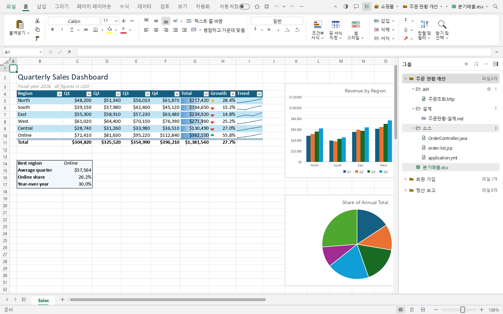
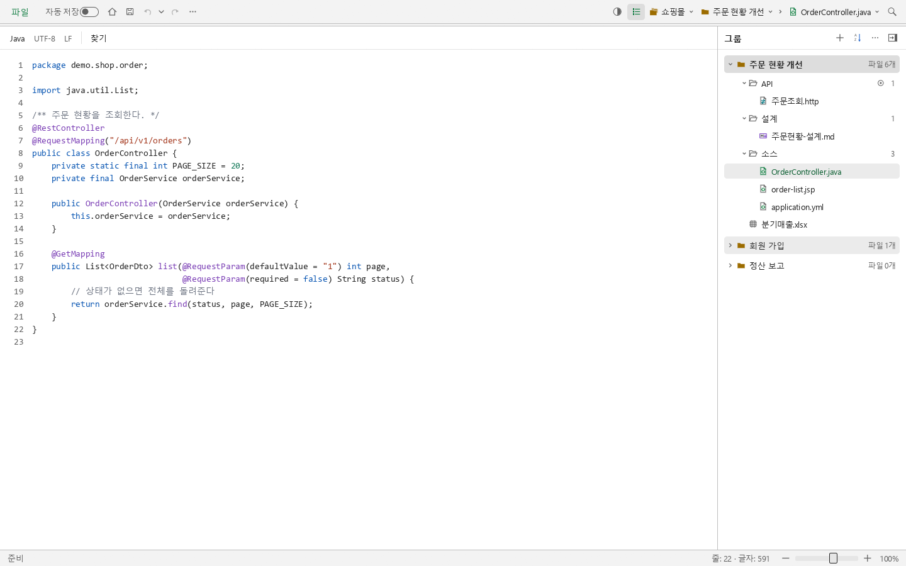
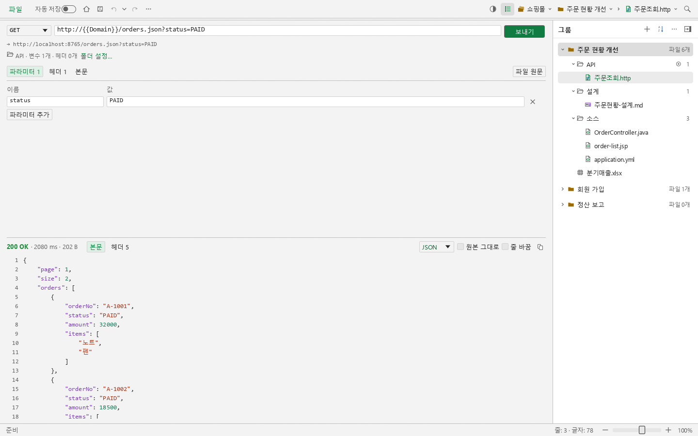
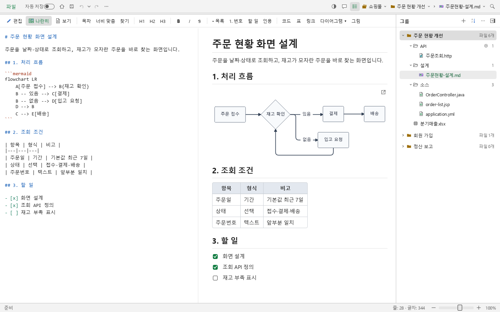

# 모눈 (Monun)

**엑셀 파일을 그대로 열고 저장하고, 문서 · 소스 · API 요청까지 한 창에서 다루는 Windows 앱**

[**⬇ 다운로드**](https://github.com/hulbo/monun/releases/latest) · [기능 안내](docs/FEATURES.md) · [릴리스 노트](https://github.com/hulbo/monun/releases) · [문의 · 버그 신고](https://github.com/hulbo/monun/issues)

## 모눈은

엑셀처럼 생기고 엑셀처럼 동작하는 스프레드시트에, 업무에 필요한 파일을 **업무 단위로 묶어** 함께 여는 기능을 더한 데스크톱 앱입니다.

- **XLSX를 그대로** 열고 저장합니다. 셀 크기 · 단축키 · 함수가 윈도우 엑셀과 같습니다.
- **Markdown · SQL · 소스 코드 · API 요청 · Word · 한글 · PDF**를 같은 창의 탭으로 엽니다.
- 파일을 **그룹 · 폴더 · 프로젝트**로 묶어 두면, 그룹을 바꿀 때 그 파일들이 그대로 다시 열립니다.
- 설치 파일 하나(약 30MB), 관리자 권한 없이 설치, 인터넷 없이 동작합니다.

## 주요 기능

| 기능 | 설명 |
|---|---|
| **엑셀 호환** | XLSX 열기 · 저장, CSV(한글 CP949 자동 인식), 500개 이상의 함수 · 동적 배열 · LAMBDA, 조건부 서식 · 표 · 차트 · 피벗 · 인쇄와 PDF |
| **업무 단위 묶음** | 그룹마다 파일과 폴더를 두고 한 번에 바꿉니다. 프로젝트는 문서 폴더에 저장되어 git으로 여러 PC가 함께 씁니다 |
| **문서** | Markdown(나란히 보기, Mermaid 다이어그램, 문단 메모), Word(.docx)와 한글(.hwp · .hwpx) 읽기 · 편집 |
| **개발 파일** | SQL · Java · JSP · Vue · JS/TS · XML · YAML · properties 등을 언어별 색으로 편집. AI 도구가 고친 파일은 바로 다시 보입니다 |
| **API 요청** | Postman처럼 요청을 보내고 JSON · XML 응답을 정렬해 봅니다. 폴더마다 변수(`{{url}}`) · 공통 헤더 · 환경(개발 · 로컬 · 운영)을 두고 요청 줄 맨 앞에서 환경을 바꿉니다 |
| **보기 전용** | PDF, 그림, PowerPoint 슬라이드, 웹 페이지 · 사이트 연결 |
| **한국 업무** | 한국어 화면, 한글 금액(`NUMBERSTRING`), 한국어 날짜, 관공서 공휴일, EUC-KR 파일 그대로 저장 |
| **안전장치** | 비정상 종료 대비 자동 복구, 연 형식 · 인코딩 그대로 저장, Word · 한글은 보기로 먼저 열기 |

## 설치

1. **[최신 릴리스](https://github.com/hulbo/monun/releases/latest)**의 Assets에서 `Monun-<버전>-Setup.exe`를 받아 실행합니다.
2. 'Windows의 PC 보호' 창이 뜨면 **추가 정보 → 실행**을 누릅니다(코드 서명이 없는 설치 파일입니다).

- Windows 10/11 x64에서 동작하고, 지금 사용자에게만 설치됩니다(`%LOCALAPPDATA%\Programs\Monun`).
- 업데이트는 새 설치 파일을 실행하면 되고, 설정(`%APPDATA%\Monun`)은 그대로 남습니다.
- 새 통합 문서의 기본 글꼴은 [D2Coding](https://github.com/naver/d2codingfont)입니다. 모눈에 들어 있지 않으니 따로 설치하세요(없으면 다른 글꼴로 보입니다).

## 빠르게 시작하기

1. 시작 화면에서 **새 엑셀 통합 문서**를 만들거나 **열기**로 파일을 엽니다. 탐색기에서 끌어다 놓아도 됩니다.
2. 오른쪽 **그룹 패널**의 `+` › 새 그룹…으로 업무마다 그룹을 만들고, 그 업무의 파일을 엽니다.
3. 파일이 많아지면 `+` › 새 폴더…로 나누고, 파일을 폴더 위로 끌어다 놓습니다.
4. 여러 PC에서 함께 쓰려면 파일 › 옵션 › 일반에서 **작업 루트 폴더**를 정하고 프로젝트를 만듭니다.

자세한 사용법은 [기능 안내](docs/FEATURES.md)에 있습니다.

## 화면

| 소스 파일 | API 요청 |
|---|---|
|  |  |

| Markdown 나란히 보기 |
|---|
|  |

## 꼭 알아 둘 점

- **문서 보안(DRM) 파일은 열 수 없습니다.** 보안 프로그램이 허용한 프로그램에서만 풀리기 때문이며, 모눈은 이를 우회하지 않습니다.
- **엑셀 VBA 매크로는 실행하지 않습니다.** 매크로가 든 파일은 .xlsm으로 저장하면 매크로가 그대로 남습니다.
- API 요청의 '숨김' 값(토큰 등)은 화면에서만 가려지고 파일에는 그대로 저장됩니다. git으로 공유하는 프로젝트에 넣을 때 주의하세요.
- 개인이 만들어 공개한 프로그램입니다. 문의와 버그 신고는 [Issues](https://github.com/hulbo/monun/issues)에 남겨 주세요.

## 문서

| 문서 | 내용 |
|---|---|
| [기능 안내](docs/FEATURES.md) | 창과 파일, 그룹 · 폴더 · 프로젝트, 메모, 엑셀, Markdown, 소스, API 요청, Word, 한글, 보기 전용 파일, 설정 |
| [릴리스 노트](https://github.com/hulbo/monun/releases) | 버전별 변경 사항과 설치 파일 |
| [개발 가이드](docs/DEVELOPMENT.md) | 직접 빌드하기, 저장소 구조, 테스트, 릴리스 만들기 |
| [기획서](docs/PLANNING.md) | 만든 배경, 목표, 원칙, 설계 |

## 라이선스

MIT 또는 Apache-2.0 중 하나를 골라 따릅니다([LICENSE-MIT](LICENSE-MIT), [LICENSE-APACHE](LICENSE-APACHE)). 모눈이 출발한 원 저작물과 함께 쓰는 오픈소스의 저작권 고지는 [NOTICE](NOTICE)에, 자산의 출처는 [ATTRIBUTION.md](ATTRIBUTION.md)에 있습니다.

한글 문서는 [rhwp](https://github.com/edwardkim/rhwp)로 다룹니다. 본 제품은 한글과컴퓨터의 한글 문서 파일(.hwp) 공개 문서를 참고하여 개발하였습니다. "한글", "한컴", "HWP", "HWPX"는 주식회사 한글과컴퓨터의 등록 상표이며, 모눈은 한글과컴퓨터와 제휴, 후원, 승인 관계가 없습니다. "Excel", "Word", "PowerPoint"는 Microsoft Corporation의 상표입니다.
